# ❄️ CoolJet — Compressorless Aerodynamic Cooling System

<div align="center">

[](https://nextjs.org/)
[](https://react.dev/)
[](https://www.typescriptlang.org/)
[](https://github.com/beast6713/cooljet)
[-00b0ff?style=for-the-badge)](https://github.com/beast6713/cooljet)
[](https://github.com/beast6713/cooljet)

<br/>

**Sub-Ambient Aerodynamic Expansion Cooling · Validated at TRL 5 · SRM Institute of Science & Technology**

<p align="center">
  <a href="#-project-overview">Overview</a> •
  <a href="#-aerodynamic-first-principles">Core Science</a> •
  <a href="#-engineering-schematics--blueprints">Blueprints & CAD</a> •
  <a href="#-institutional-pitch-deck-slide-gallery">Slide Gallery</a> •
  <a href="#-market-validation--financials">Market & Financials</a> •
  <a href="#-tech-stack--architecture">Tech Stack</a> •
  <a href="#-getting-started">Getting Started</a>
</p>

</div>

---

<div align="center">
  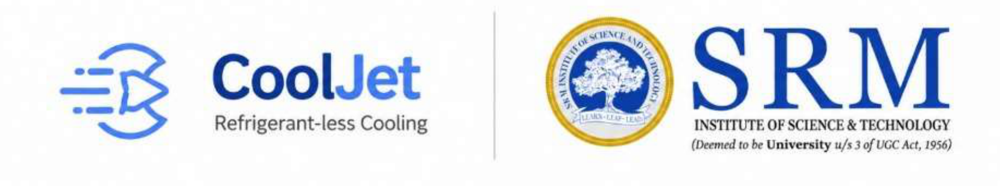
</div>

---

## 🌬️ Project Overview

**CoolJet** is a disruptive thermodynamic cooling system engineered to eliminate mechanical vapor-compression refrigeration (VCRS). By replacing heavy, energy-guzzling compressors and potent greenhouse synthetic refrigerants (HFCs/CFCs like R410A, R32) with high-velocity **Convergent-Divergent (C-D) Nozzle Aerodynamics**, CoolJet produces continuous sub-ambient cooling using ambient air as its sole working fluid.

### Key Value Propositions
- **Zero Chemical Refrigerants (0 GWP / 0 ODP)**: Eliminates synthetic refrigerants completely, eliminating leakage liabilities and regulatory phase-out risks.
- **Up to 60% Lower Power Consumption**: Replaces high-torque multi-kilowatt compressors with precision-aerodynamic brushless blowers.
- **TRL 5 Physical Validation**: Validated under relevant operating conditions with prototype fabrication and instrumentation at **SRM Institute of Science & Technology**.
- **Solid-State Fluid Mechanics**: Dramatically fewer moving parts, zero oil/refrigerant loop maintenance, and modular scalability from electronic server racks to automotive EV cabins and commercial HVAC.

---

## 🔬 Aerodynamic First Principles

CoolJet leverages fundamental fluid dynamics and gas law expansions:

```
  +------------------+     +-------------------+     +------------------+     +--------------------+
  |  Ambient Intake  | --> | High-Flow Blower  | --> | Convergent Zone  | --> | Sonic Throat (M=1) |
  |  P0, T0 (32°C)   |     | Induction Duct    |     | Acceleration     |     | Minimum Area A*    |
  +------------------+     +-------------------+     +------------------+     +--------------------+
                                                                                        |
                                                                                        v
                                                            +--------------------------------------+
                                                            | Divergent Supersonic Expansion Zone  |
                                                            | P << P0, T_static << T0 (18°C - 21°C)|
                                                            | Cooled Air Stream to Living/IT Space |
                                                            +--------------------------------------+
```

1. **Convergent Section**: Incoming ambient air is accelerated subsonically toward the throat, converting static pressure into bulk kinetic velocity ($A_1 > A^*$, $M < 1$).
2. **Sonic Throat ($A^*$)**: Air reaches sonic velocity ($M = 1$) at minimum cross-sectional area under choked flow conditions.
3. **Divergent Expansion Section**: Rapid geometric expansion triggers a dramatic drop in static temperature ($\Delta T$) and pressure through combined Bernoullian velocity conversion and Joule-Thomson expansion:
   $$\frac{T}{T_0} = \left(1 + \frac{\gamma - 1}{2} M^2\right)^{-1}$$
4. **Sub-Ambient Recovery**: Cooled air exits directly into conditioned zones without thermal penalties from heat exchanger coils.

---

## 📐 Engineering Schematics & Blueprints

### 1. Convergent-Divergent Nozzle Dimension Blueprint (Figure 5.3)
Detailed engineering drawing specifying nozzle intake radii, convergent angle, throat diameter ($d^*$), divergent divergence half-angle ($\theta$), and total axial length.

<div align="center">
  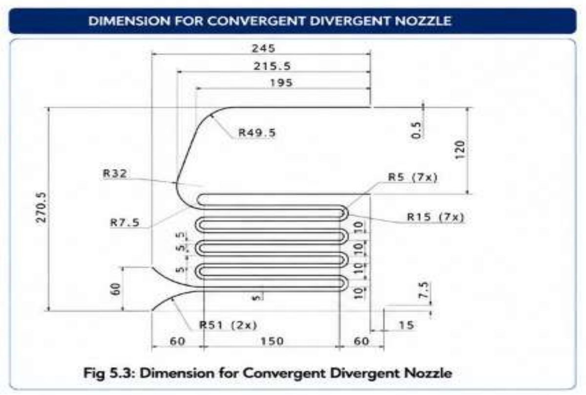
  <p><em>Figure 5.3 — Precision dimensional specifications of the CoolJet micro-nozzle array.</em></p>
</div>

---

### 2. 3D CAD Design of C-D Nozzle (Figure 5.1 & Figure 5.2)
SolidWorks CAD modeling showing both front intake geometry and rear divergent discharge profiles for multi-nozzle matrix integration.

<div align="center">
  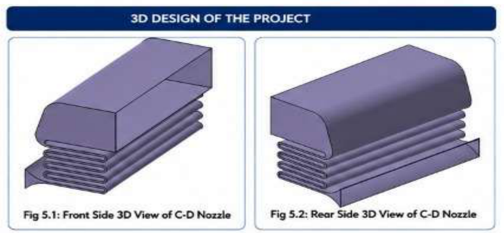
  <p><em>Figure 5.1 & 5.2 — Front intake geometry and rear aerodynamic expansion contours.</em></p>
</div>

---

### 3. Indoor Unit System & Aerodynamic Ducting Architecture
Complete assembly cutaway showing the air intake plenum, multi-stage induction fan, aerodynamic pressure plenum, and parallel C-D nozzle discharge bank.

<div align="center">
  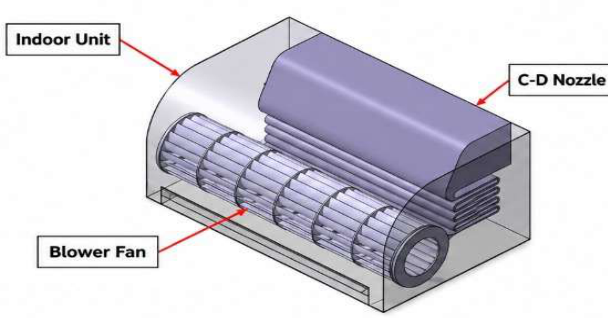
  <p><em>Cutaway architecture of the CoolJet indoor cooling unit and airflow distribution channel.</em></p>
</div>

---

### 4. Technology In Action: Operational Sequence Diagram
Sequence flow documenting ambient intake, blower induction, static temperature plunge at the throat, and cooled airflow output.

<div align="center">
  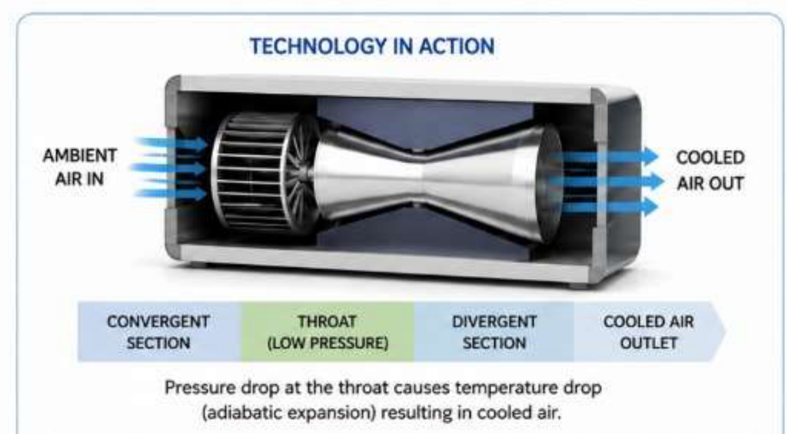
  <p><em>End-to-end fluid mechanics validation flow sequence from Slide 5.</em></p>
</div>

---

## 📊 Market Validation, Financials & Milestones

### 1. Market Opportunity & Growth Drivers
The global cooling and air conditioning market is projected to reach massive scale driven by global warming, electrification, and data center thermal density.

<div align="center">
  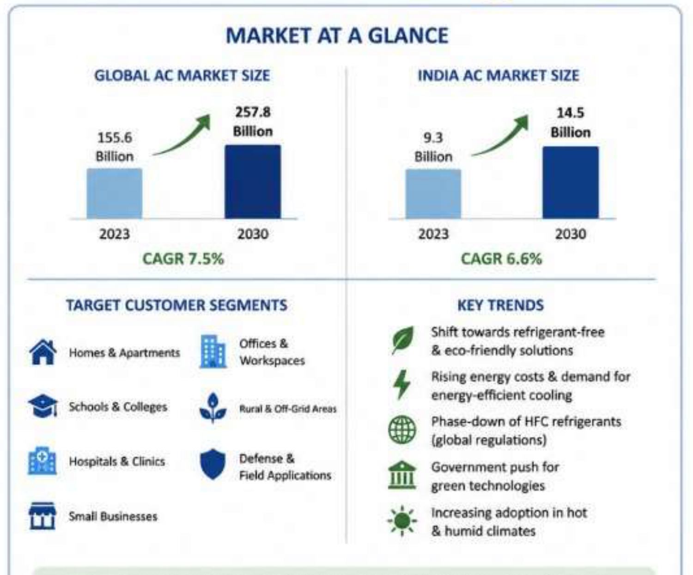
  <p><em>Market At A Glance: Rapid expansion in HVAC, EV thermal management, and industrial IT cooling.</em></p>
</div>

---

### 2. 3-Year Financial Projections & Use of Funds
Commercialization roadmap showing projected unit sales, revenue trajectory, and structured allocation of capital.

| 3-Year Financial Projection | Use of Funds Allocation |
| :---: | :---: |
| 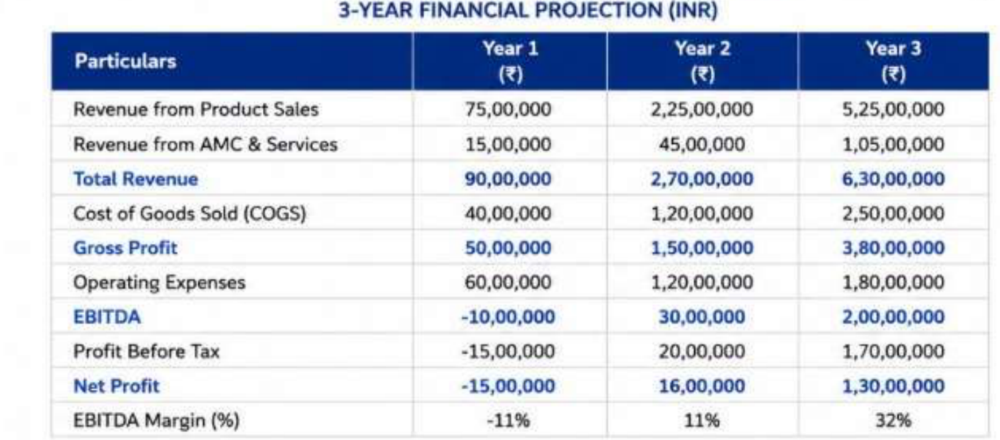 | 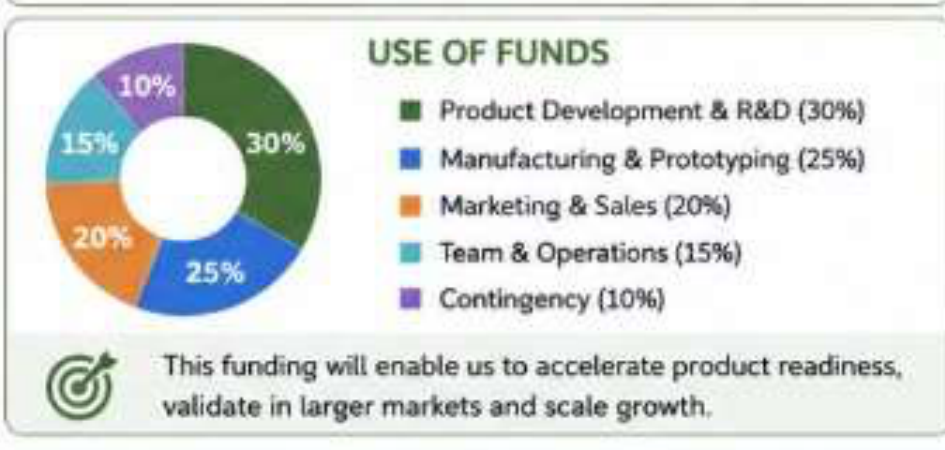 |
| *Projected revenue & unit ramp across target segments* | *Capital distribution across R&D, tooling, and field trials* |

---

### 3. Project Milestone Budget & IVP Support Split-Up
Documented budget breakdown across prototype development, nozzle micro-machining, instrumentation sensors, wind tunnel testing, and patent prosecution.

<div align="center">
  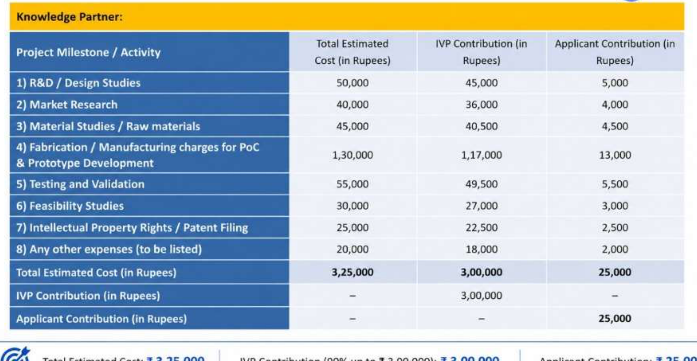
  <p><em>Slide 11 milestone budget breakdown including ₹3,00,000 IVP incubation support.</em></p>
</div>

---

## 📑 Institutional Pitch Deck Slide Gallery

Complete official pitch deck presented for incubation and institutional support at **SRM Institute of Science & Technology**:

<details open>
<summary><strong>🔍 Click to expand/collapse full 11-slide presentation</strong></summary>

<br/>

### Slide 1: Cover & Institutional Affiliation
*Official deck title, startup branding, and SRM IST presenter affiliation.*
<div align="center">
  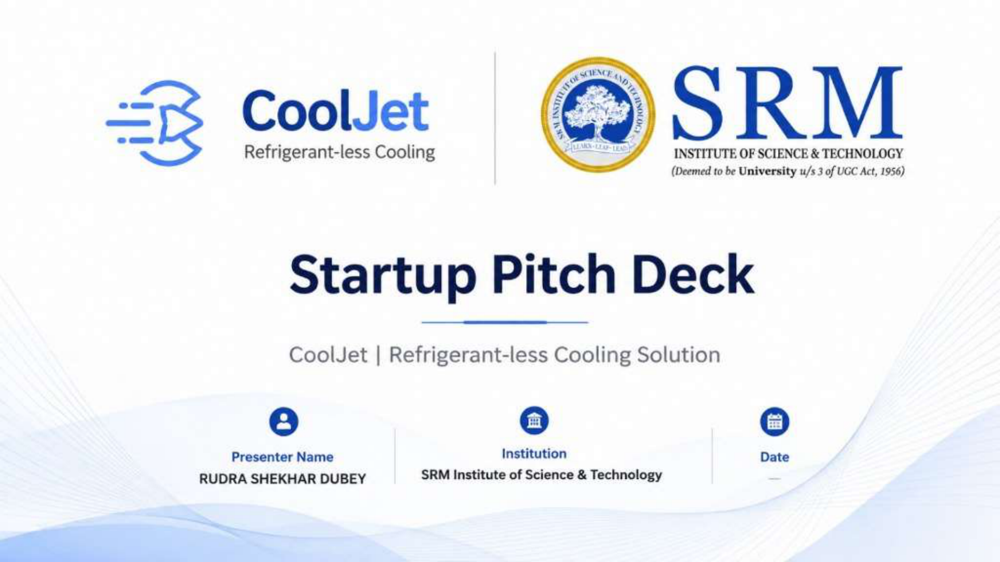
</div>

<br/>

### Slide 2: The Global Cooling Challenge
*Inefficiencies, electricity grid strain, and emissions of vapor compression air conditioning.*
<div align="center">
  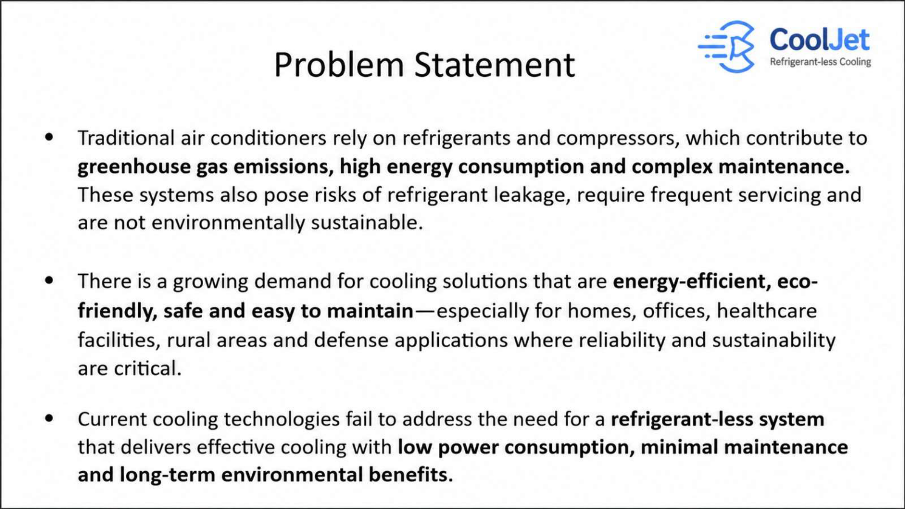
</div>

<br/>

### Slide 3: The CoolJet Proposed Solution
*Aerodynamic expansion nozzle engineering and compressor elimination.*
<div align="center">
  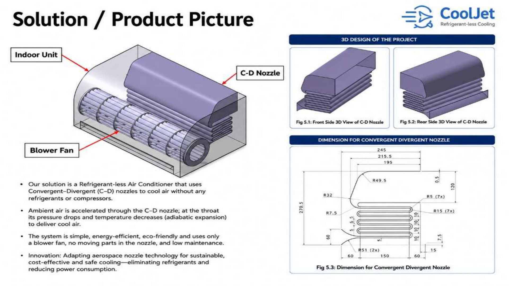
</div>

<br/>

### Slide 4: Market Opportunity & Industry Size
*Addressable market segments spanning domestic HVAC, commercial buildings, EV mobility, and IT racks.*
<div align="center">
  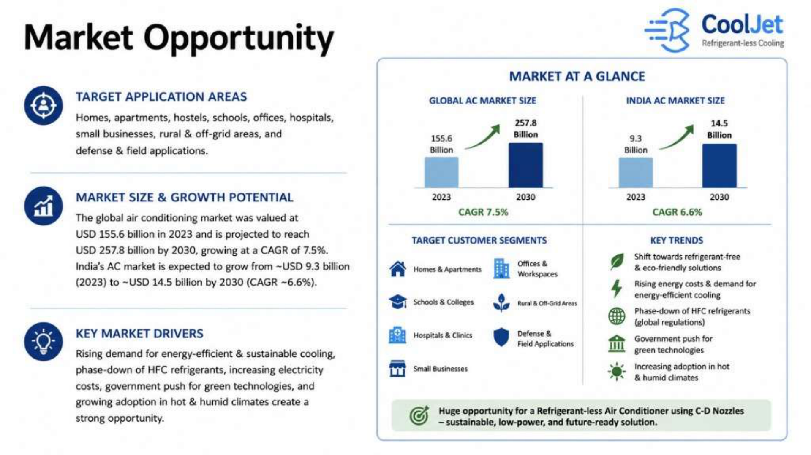
</div>

<br/>

### Slide 5: Technology In Action & Operational Sequence
*Aerodynamic stage-by-stage progression from ambient air intake to cooled discharge.*
<div align="center">
  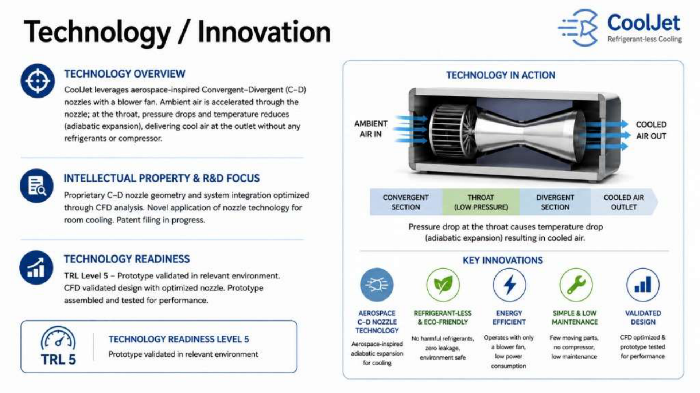
</div>

<br/>

### Slide 6: Product Architecture & Industrial Design
*Modular enclosure, noise baffling, compact footprint, and ducting integration.*
<div align="center">
  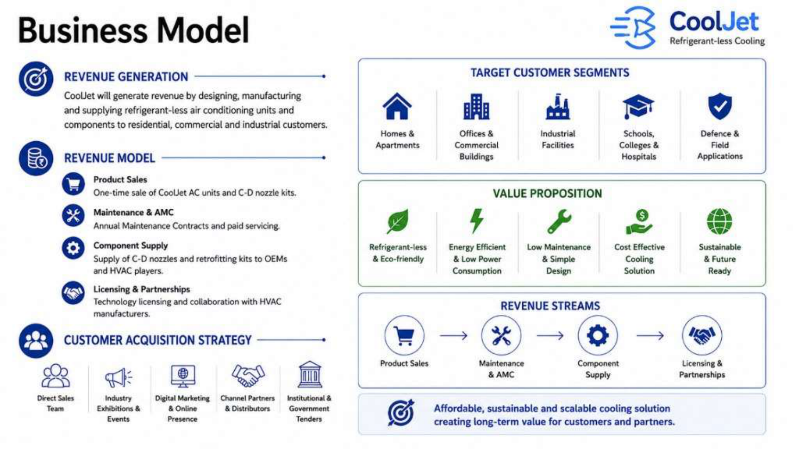
</div>

<br/>

### Slide 7: Competitive Matrix & Benchmark
*Side-by-side comparison: CoolJet vs Vapor Compression vs Evaporative vs Thermoelectric systems.*
<div align="center">
  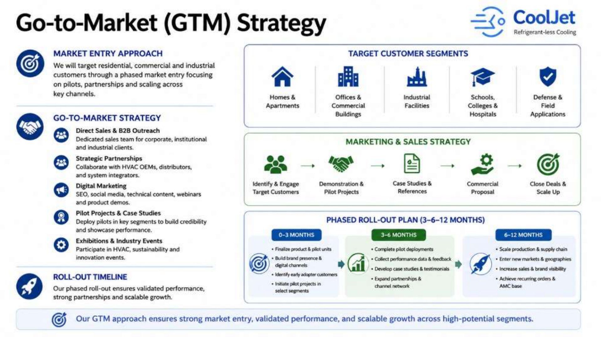
</div>

<br/>

### Slide 8: Business Model & Monetization Strategy
*OEM licensing, direct unit sales, B2B data center retrofits, and aftermarket maintenance.*
<div align="center">
  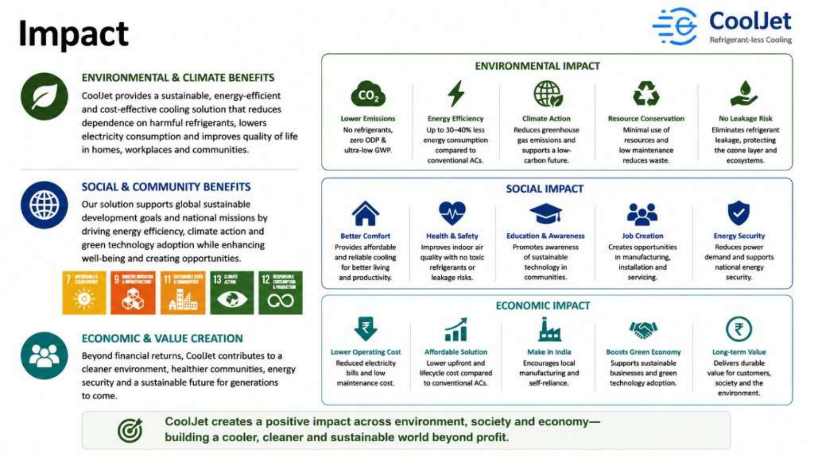
</div>

<br/>

### Slide 9: Traction & Go-To-Market Roadmap
*Institutional backing, prototype validation milestones, and commercial partner pilots.*
<div align="center">
  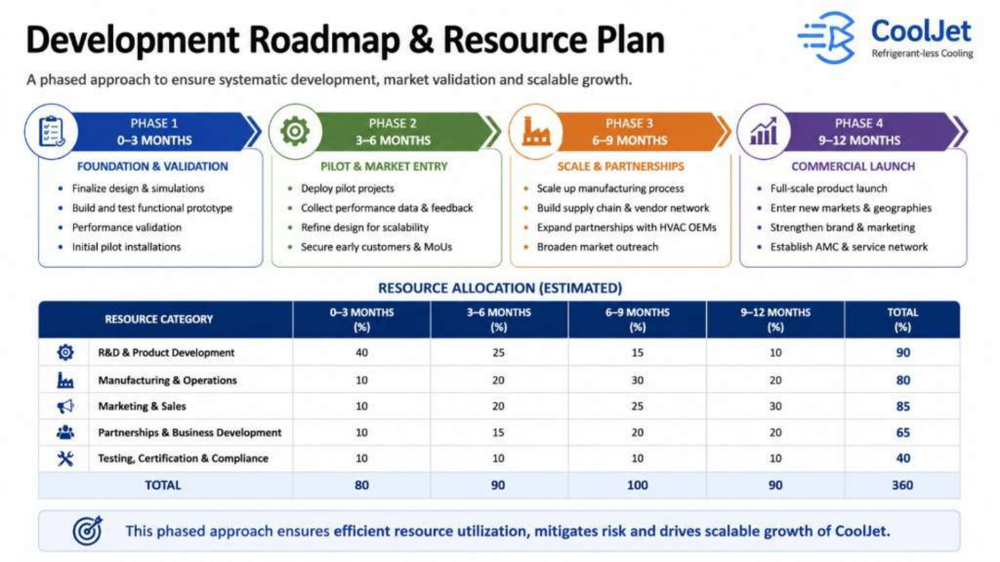
</div>

<br/>

### Slide 10: Financial Projections & Funding Requirements
*Unit economics, COGS projections, capital efficiency, and 36-month burn runway.*
<div align="center">
  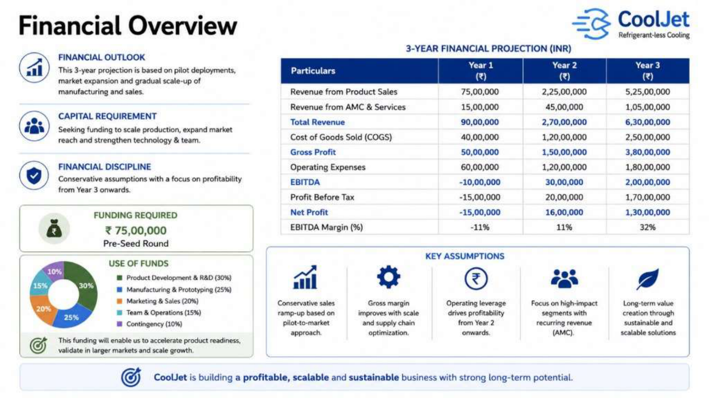
</div>

<br/>

### Slide 11: Milestones & Budget Allocation Plan
*Activity-level budget allocation covering R&D, fabrication, testing, and patent filings.*
<div align="center">
  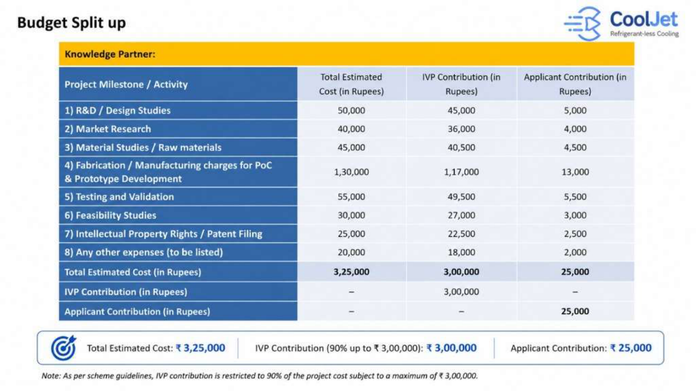
</div>

</details>

---

## 💻 Tech Stack & Web Platform Features

This repository contains the interactive Next.js web application showcasing CoolJet's technology:

- **Next.js 16 (App Router & Turbopack)**: High-performance React server components with fast client transitions.
- **Interactive CFD Nozzle Explorer**: Real-time interactive calculation of throat pressure, static temperature delta, and flow Mach number.
- **Pitch Deck Lightbox & PDF Viewer**: Modal slide viewer with high-resolution photo zooming and direct download for `cooljet_pitch_deck.pdf`.
- **Aerospace Design System**: Custom Vanilla CSS with responsive typography, glassmorphism, and subtle fluid-state micro-animations.
- **Comparison Engine**: Interactive matrix benchmarking CoolJet against conventional VCRS, evaporative, and Peltier cooling.

---

## 📂 Repository Structure

```
cooljet/
├── app/
│   ├── globals.css              # Custom aerospace-grade design tokens & utility styles
│   ├── layout.tsx               # Root layout & SEO meta tags
│   └── page.tsx                 # Main application dashboard
├── components/
│   ├── ApplicationsSection.tsx  # Industry use-cases (EVs, Data Centers, Residential)
│   ├── ContactSection.tsx       # Partner & pilot inquiry interface
│   ├── EngineeringCallouts.tsx  # Aerodynamic specification badges
│   ├── FlowStateVisualizer.tsx  # Dynamic fluid state visualizer
│   ├── HowItWorksMode.tsx       # Step-by-step aerodynamic walkthrough
│   ├── NozzleExplorer.tsx       # Interactive C-D nozzle fluid mechanics simulator
│   ├── PitchDeckGallery.tsx     # Modal slide viewer with download capabilities
│   ├── ProductExplorer.tsx      # Multi-angle product model selector
│   ├── TeamSection.tsx          # Project leadership & advisory
│   ├── TechnologyComparison.tsx # Multi-attribute engineering benchmark matrix
│   ├── TechnologyFlow.tsx       # Interactive flow sequence controller
│   ├── TechnologySection.tsx    # Core technology overview
│   ├── ValidationSection.tsx    # TRL 5 validation evidence & SRM IST affiliation
│   └── VideoShowcase.tsx        # High-definition video player showcase
├── data/
│   └── technologyData.ts        # Specifications, thermodynamics parameters & benchmarks
├── public/
│   ├── cooljet-video.mp4        # Product animation video
│   └── ppt/                     # All project photos, diagrams, CAD blueprints & slides
│       ├── cd_nozzle_3d_design_fig5.png
│       ├── cd_nozzle_engineering_dimensions_fig5_3.png
│       ├── cooljet_indoor_unit_system.png
│       ├── cooljet_pitch_deck.pdf
│       ├── cooljet_srm_brand_header.png
│       ├── financial_3year_projections.png
│       ├── market_opportunity_charts.png
│       ├── project_budget_split_table.png
│       ├── slide_1.png ... slide_11.png
│       ├── technology_in_action_diagram.png
│       └── use_of_funds_breakdown.png
├── package.json
├── pnpm-lock.yaml
├── tsconfig.json
└── README.md
```

---

## 🚀 Getting Started

### Prerequisites
- **Node.js** >= 18.18.0
- **pnpm** (recommended) or **npm**

### Quickstart

```bash
# 1. Clone the repository
git clone https://github.com/beast6713/cooljet.git
cd cooljet

# 2. Install dependencies
pnpm install
# or
npm install

# 3. Start local development server
pnpm dev
# or
npm run dev
```

Visit **`http://localhost:3000`** in your browser to experience the platform.

---

## 📜 Intellectual Property & Institutional Acknowledgments

- **Technology**: Convergent-Divergent Aerodynamic Sub-Ambient Air Cooling System.
- **Academic & Incubation Institution**: **SRM Institute of Science & Technology**.
- **TRL Status**: Technology Readiness Level 5 (Physical Component Validation in Relevant Environment).
- **Founder / Presenter**: Rudra Shekhar Dubey.

---

<div align="center">
  <sub>Developed for CoolJet Technologies · SRM Institute of Science & Technology · All Rights Reserved</sub>
</div>
